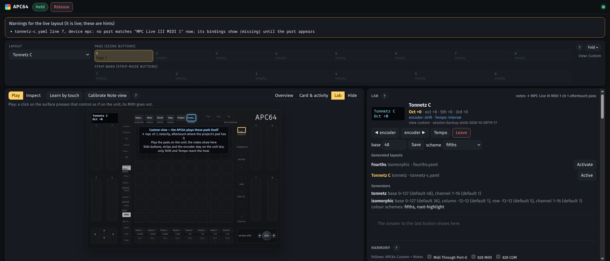
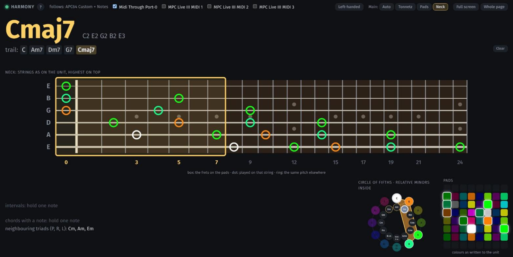

# APC64 Control

A Linux host and layout lab for the **Akai APC64**, in two parts: the **Host** and the **Lab** (below).



## Quick start

Linux with Python 3.14+ and the APC64 on USB:

```sh
git clone https://github.com/esazhin/apc64-control.git && cd apc64-control
./start.sh                  # the first run sets everything up; then open http://localhost:5058/
```

1. On the page, answer **Yes** to "Take control of APC64?".
2. Open **Lab** beside the surface and **Activate** a generated layout (`Guitar`, `Tonnetz C`, `Fourths` …). The
   unit switches to Custom view and the pads take the layout. The encoder moves it, Tempo changes the step.
3. To hear it, set where the pads play in `config.local`, e.g. `APC64_LAB_TARGET=MPC Live III MIDI 1 ch 1
   aftertouch pass` (a port name as `.venv/bin/apc64 ports` lists it), and run `./start.sh` again.

No APC64 at hand? `./start.sh --simulate` runs a simulated unit. `./start.sh --install` runs it at login as a
systemd user service, with a desktop launcher. More in [Install](#install).

## What it is

The Host is a Linux service that hosts the **Akai APC64** in its DAW ("Ableton") mode — without Ableton — when, and only
when, you say yes. Every pad, button, touch strip and the encoder does what the current **layout** says: MIDI to
any named port (the MPC, Bitwig, anything ALSA can see). The pads stay expressive: in the unit's own Note, Chord,
Step and Custom views, what you play is routed with velocity and aftertouch as played.

A page on your home network shows a live replica of the whole unit with every control labelled with what it does
**right now**, and an agent (Claude Code) drives everything through the `apc64` command and the same HTTP API.

- Layouts are short YAML files in `layouts/` — written by an agent, validated precisely, live within a second.
  Guide: [`docs/layout-guide.md`](docs/layout-guide.md); schema: [`docs/layout.schema.json`](docs/layout.schema.json).
- API and CLI reference: [`docs/api.md`](docs/api.md).
- The unit's own project and global-settings memory is written only by the layout lab's guarded write path
  (below): a backup first, the change merged with every unknown byte kept, then a read-back, rolled back if it
  differs. Every other 0x14/0x18 is refused at the one gate to the unit. Nothing is ever sent to the unit's
  Notes, MIDI or Custom ports.

> **Not affiliated with or endorsed by Akai Professional or inMusic.** Verified only on APC64 firmware
> **1.2.1.6**; on other firmware the host warns. The protocol, as far as it is known, is in
> [PROTOCOL-SPEC.md](PROTOCOL-SPEC.md) and [NOTES-daw-mode.md](NOTES-daw-mode.md).

## The layout lab

The lab is the **Lab** choice beside the surface on the same page, plus `apc64 lab …` and `/api/lab…`.

- **Generated layouts:** a layout file with a `lab:` section names a generator (the Tonnetz on a staggered
  checkerboard, isomorphic layouts, the modes explorer, a guitar or bass neck, or a plugin) and a colour scheme (the fifths hue, a root
  highlight, or a scale overlay from a library of some 40 scales, many the unit's Note view lacks). When it is activated, all 64 pads go into
  the live edit buffer (slot 0), after one backup. You play them in the unit's **Custom view**, with real
  velocity and per-pad aftertouch.
  - The encoder shifts the window one step of the interval; Tempo cycles octave → fifth → third; the OLED shows
    the window. A guitar layout has its own steps: Fret and Page (Tempo toggles them), the OLED showing the frets
    on the pads (`Frets 3-10`) and its pads mark the inlay frets.
  - Shift + encoder still browses layouts. Leaving the layout (or releasing the unit) restores slot 0.
  - Examples: `layouts/tonnetz-c.yaml`, `layouts/fourths.yaml`, `layouts/thirds-grid.yaml`,
    `layouts/wicki-hayden.yaml` (a square approximation), `layouts/janko.yaml`, `layouts/fifths-grid.yaml`,
    `layouts/modes-c.yaml`, and the guitar necks `layouts/guitar.yaml` (6 strings, E standard),
    `layouts/guitar-7.yaml` (B standard) and `layouts/guitar-8.yaml` (F♯ standard), each string on its own MIDI
    channel.
- **Harmony views:** what is played, live, following the active layout: the Tonnetz lattice with its triads for a
  Tonnetz layout, the neck for a guitar layout (the frets on the pads boxed, each played note on its string and
  its other places ringed), otherwise a large pad grid in the layout's own shape (note names, held notes, chord
  tones, scale dimming, the modes' row names); the chord (notes spelled in their chord or key) and its trail of
  the last 8 chords (with Clear), interval and neighbour hints, and the circle of fifths
  with the relative minors inside. They follow the APC64 and any MIDI
  input you choose. **Full screen** and **New tab** on the Harmony heading show them alone, large;
  `http://<this machine>:5058/?view=harmony` opens that full view directly (a bookmark, a tablet, a second screen).

  
- **Project memory:**
  - back up all 25 slots and the global settings in one command;
  - restore one slot;
  - push a layout or a library entry to slot 1–24;
  - capture a slot into `library/`;
  - import an Akai `.APC64` file;
  - preview a library entry live;
  - bulk-edit a stored project (agent only).

  Backups go to `backups/` (dated, git-ignored, never deleted).
- **Global settings:** CV/Gate sources and channels, drum notes, LED level, sync and device mode. Each change is
  backed up first, and device-mode and sync changes need an explicit confirmation.
- When you load or save a project on the unit, the lab session ends quietly and nothing is written over your
  project. Each session also backs up slots 1–24, so an on-unit save of a generated layout can be undone.

Writing generated layouts: [`docs/lab-guide.md`](docs/lab-guide.md) and
[`docs/lab.schema.json`](docs/lab.schema.json). Routes and commands: [`docs/lab-api.md`](docs/lab-api.md). A new
generator or colour scheme is one file in `_apc64_lab/generators/` plus its test.

## Taking, releasing, Busy — and Bitwig

The host never takes the APC64 on its own. When the unit appears (or the service starts with it plugged in) it
asks **"Take control of APC64?"** in a desktop notification and in a banner on the page. On **Yes** (page,
notification, or `apc64 take` from an agent you asked) it opens the unit's ports exclusively, checks it is an
APC64, enters DAW mode and draws the layout.

- **While the host holds the APC64, Bitwig cannot use it.** Click **Release** (or `apc64 release`) first: the
  LEDs and OLED go dark, DAW mode is switched off and the port is free for Bitwig at once.
- If another program holds it (Bitwig, or Chrome with a Web MIDI page open), the page says
  **Busy: held by …** and the host sends nothing. It never fights for the unit; when the port frees it asks again.
  Close the Web MIDI tab (or quit Bitwig) to free it. The host's own page never asks the browser for MIDI access.
- Release, stopping the service (also at shutdown) and unplugging always leave DAW mode and free the port. After a
  crash the page says **APC64 may still be in DAW mode: Take to reset, or replug it**.
- Each yes covers one holding: after a release, replug or restart it asks again. `APC64_AUTO_ACCEPT=1` in
  `config.local` makes it take the unit without asking.

## The page

Open **http://localhost:5058** (or `http://<this machine>:5058` from a phone on the home network — no login).

- **Nav bar:** layout, pages 1–8 (scene buttons) and strip banks 1–6 (strip-mode buttons) with their names —
  current, defined, empty. It folds to one line (layout, page, bank, view); folded by default on short screens,
  and the choice is remembered in this browser.
- **Replica:** the whole unit, laid out as its top panel (the OLED where the AKAI logo is) and scaled to fit the
  window. Each control shows what it does now (`Note 36 / mpc`, `CC118 / mpc`), or a dashed `—` when nothing is
  bound. LEDs, strip bars and the OLED mirror the unit (colours are approximate). **Shift** is on the surface: hold
  it and every label shows its Shift meaning. **Play** mode: a click presses the control exactly like the hardware;
  **Inspect**: a click only shows its card. The line under the toolbar says which (or the learn / calibration step
  while one runs). Outside Session view the pad grid is the unit's: it shows dark, with a
  caption saying where the unit's own playing is routed, and clicking a pad sends nothing; in Custom view the side
  buttons, strips and encoder are the unit's too (only Shift and Tempo reach the host). The **view buttons**
  (Session, Note, Chord, Step, Custom) switch the unit while the host holds it, as pressing them on the unit
  does; Project stays the unit's own.
- **Beside the surface** (toolbar: Overview · Card & activity · Hide): the **overview** by default — every page as
  a mini grid and every bank as a strip set, scaled to the column; click one to go there. **Card & activity**
  swaps in the control card and the activity list (a debugging aid); **Hide** gives the surface the whole width.
  Remembered in this browser; selecting a control in Inspect mode shows the card.
- **Card:** both layers, momentary/toggle, feedback, port status and where else the control is bound (one click
  to go there); **MIDI-learn** from a port; and a **single-control tweak** (assignment, label, colour, mode) saved
  as one line in the layout file — comments and ranges stay as written. `#pad%20r1c1` in the address opens a card.
- **Learn by touch:** touch a control on the unit to select it (nothing is sent while learning).
- **Calibrate Note view:** press the bottom-left, then the top-right pad in Note view so played notes light their
  pads — always labelled *calibrated … (assumed)*, since the unit's Note settings cannot be read.
- **Harmony full view:** `/?view=harmony` is the page with only the harmony views, across the window (Lab → Harmony
  → **Full screen** or **New tab**); Esc or Leave ends the in-page one.
- **Help:** the small **?** buttons (layout bar, toolbar, Lab and Harmony headings) open a short explanation;
  ×, a click outside or Esc closes it.
- **Activity:** the latest 200 actions, `control → message → port: sent / not sent (why) / refused`.
- Validation errors of any layout file are shown plainly at the top until the file is fixed.

## Requirements

- Linux with ALSA; `amidi` (alsa-utils) to find the unit and `notify-send` (libnotify) for the desktop question.
- Python ≥ 3.14. Node.js only for the page's tests.
- An Akai APC64 on USB, or none at all with `--simulate` (below).

## Install

Clone and start:

```sh
git clone https://github.com/esazhin/apc64-control.git && cd apc64-control
./start.sh                  # sets up .venv on the first run, then serves; open http://localhost:5058/
./start.sh --simulate       # no APC64 needed: a simulated unit
./start.sh --install        # optional: run it as a systemd user unit at login, plus a desktop launcher
```

`./start.sh --uninstall` removes the unit and the launcher; `./start.sh --help` lists the options, and any other
arguments go to the service (`--port 5791`). The steps it runs, by hand:

```sh
python3.14 -m venv .venv
.venv/bin/pip install -e '.[dev]'           # [dev]: pytest and httpx, for the gates
cp config.local.example config.local      # optional: port, listen address, dirs, networks, auto-accept, lab target
```

`config.local` (git-ignored, `KEY=VALUE` lines) holds everything machine-specific; real environment variables
override it. Every key and its default is in [`config.local.example`](config.local.example) and the table below.

Run it in a terminal (real APC64; Ctrl-C releases the unit):

```sh
.venv/bin/python -m _apc64_host
```

Install it as a **systemd user unit** started at login (it still asks before taking the unit), and the launcher:

```sh
mkdir -p ~/.config/systemd/user
sed "s|<repo>|$PWD|g" deploy/apc64-host.service > ~/.config/systemd/user/apc64-host.service
systemctl --user daemon-reload
systemctl --user enable --now apc64-host
journalctl --user -u apc64-host -f          # its log
cp deploy/apc64-host.desktop ~/.local/share/applications/
```

`systemctl --user stop apc64-host` releases the unit (clear → DAW mode off → port freed) before it exits.

### Development run with the simulated APC64

No ALSA device is opened and no desktop notification is shown; replica clicks go to in-memory MIDI ports
(example ports: `MPC Live III MIDI 1`, `Bitwig Studio In`, `USB MIDI Interface MIDI 1`). Point it at a copy of the layouts if
you want to try tweaks without touching `layouts/`:

```sh
APC64_LAYOUTS_DIR=/tmp/apc64-layouts .venv/bin/python -m _apc64_host serve --simulate --host 127.0.0.1 --port 5791
```

## Configuration (`config.local`, overridable by environment)

| key | default | meaning |
|---|---|---|
| `APC64_HTTP_PORT` | `5058` | page and API port |
| `APC64_HTTP_HOST` | `::` | listen address: `::` = every IPv6 and IPv4 address; `127.0.0.1` = this machine only (`serve --host` overrides it) |
| `APC64_LAYOUTS_DIR` | `layouts` | layout files (tracked in git) |
| `APC64_STATE_DIR` | `~/.local/state/apc64-host` | version copies, holding marker, calibration, last page/bank (outside git) |
| `APC64_ALLOWED_NETWORKS` | loopback, RFC 1918, link-local, IPv6 `::1`/`fe80::/10`/`fc00::/7` | who may use the page and API; add e.g. `100.64.0.0/10` for Tailscale |
| `APC64_AUTO_ACCEPT` | `0` | `1`: take the unit without asking |
| `APC64_PORT_STEM` | `APC64` | the start of the unit's ALSA port names |
| `APC64_LAB_TARGET` | empty | the lab's default note target, e.g. `MPC Live III MIDI 1 ch 2 aftertouch pass` (empty: notes are only shown unless a layout routes them) |
| `APC64_LAB_BACKUPS_DIR` | `backups` | unit-memory backups (git-ignored) |
| `APC64_LAB_LIBRARY_DIR` | `library` | captured and imported projects (git-ignored: your own data) |

Relative directories are under the repository. The `apc64` command reaches the service at
`http://127.0.0.1:$APC64_HTTP_PORT`; set `APC64_URL` in the environment to reach one on another machine.

## For agents

```sh
apc64 validate layouts/new.yaml            # works even when the service is down ("ports not checked")
apc64 layouts && apc64 load "Tonnetz C" && apc64 page 3
apc64 state
apc64 watch --json                         # what is played, one JSON event per line
```
Exit codes: 0 done, 1 refused or invalid, 2 service not running. Full reference: [`docs/api.md`](docs/api.md).

```sh
apc64 lab validate layouts/tonnetz-d.yaml  # a generated layout (works offline too)
apc64 lab activate "Tonnetz D"             # slot 0, after one backup; play it in Custom view
apc64 lab harmony                          # chord, triads, hints, trail
apc64 lab backup && apc64 lab push "Tonnetz D" 7 && apc64 lab globals led_level=100
```
Lab reference: [`docs/lab-api.md`](docs/lab-api.md).

## Gates

```sh
.venv/bin/python -m pytest -q                               # hermetic (simulated APC64; no ALSA device)
(cd _apc64_host/presentation/static && node --test)          # the page's modules (also run from pytest)
(cd _apc64_lab/presentation/static && node --test)           # the lab panel's modules (also run from pytest)
APC64_LIVE=1 .venv/bin/python -m pytest -m live              # with the unit attached and free; ends out of DAW mode
```

## Layout of the code

`_apc64_host/` follows the layers of the author's [MOTU 828 mixer](https://github.com/esazhin/motu-828-mixer): `domain/` (pure model: controls, layouts, the one resolver,
surface, router), `protocol/` (APC64 SysEx/LED/OLED codecs), `notation/` (the YAML format: parser, compiler,
splice, schema), `application/` (session, engine, outbound gate, pipeline, library, tweaks, learn, calibration,
activity, play stream, state view), `infrastructure/` (ALSA rawmidi and sequencer, unit locator, layout files,
stores, notifier, the simulated APC64), `presentation/` (network guard, API, WebSocket hub, view model, CLI and
the static page), and `__main__.py`, the one composition root.

`_apc64_lab/` (contract 2) has the same layers beside it. `domain/` holds the records and memory SysEx, the
generators, the window, the lab session and the pure harmony core in `domain/harmony/` (standard library only).
`application/` holds the guarded writer (the only holder of the write capability), the session, project memory,
globals, the harmony tracker and the LabModule. `infrastructure/` holds unit memory over the host's gate, the
backup, library and settings files, and plugin discovery. `presentation/` holds the router, the CLI, the
publisher, the schema and the panel. `generators/` holds the plugins, and `composition.py` is build_lab. The host
core never imports the lab; `_apc64_host/__main__.py` registers it.

## Documents

- [`docs/layout-guide.md`](docs/layout-guide.md), [`docs/layout.schema.json`](docs/layout.schema.json): writing layouts.
- [`docs/api.md`](docs/api.md): the HTTP API, the WebSocket and the `apc64` command.
- [`docs/lab-guide.md`](docs/lab-guide.md), [`docs/lab.schema.json`](docs/lab.schema.json),
  [`docs/lab-api.md`](docs/lab-api.md): the layout lab.
- [`PROTOCOL-SPEC.md`](PROTOCOL-SPEC.md), [`NOTES-daw-mode.md`](NOTES-daw-mode.md): the APC64's protocol as observed.
- [`fixtures/README.md`](fixtures/README.md): the captures the tests replay (serial numbers masked).
- [`docs/delivery-contract-host.md`](docs/delivery-contract-host.md) and
  [`docs/delivery-contract-lab.md`](docs/delivery-contract-lab.md): the design contracts the host (contract 1)
  and the lab (contract 2) were built against, published as design records. Code comments cite their row IDs
  (`A55`, `d84`, `§2.7`, `T23`, `s54` …).
- `tools/`: the stand-alone probes used to learn the protocol (most need `python-rtmidi`). They open the unit
  directly, so release it in the host first.

## Licence

[Apache License 2.0](LICENSE). See [NOTICE](NOTICE) for the trademark note and what the fixtures contain.
